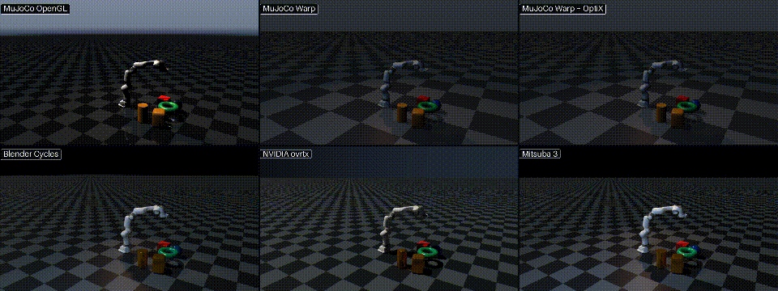

# Robotic Renderers

A research prototype comparing six rendering pipelines on one deterministic Franka
FR3 scene. Geometry, robot motion, cameras, materials, and lighting originate in
[`scene.py`](src/robotic_renderers/scene.py).

[](videos/all_tiled.mp4)

Select the preview for the original **30-second, 24 FPS, 3840x1440** comparison.
Each tile is 1280x720. This example predates the `warp-optix` backend.

## Setup

Use Python 3.12 and [uv](https://docs.astral.sh/uv/). Run commands from the checkout:

```bash
git clone https://github.com/tkelestemur/robotic_renderers.git
cd robotic_renderers
uv sync --locked
uv run robotic-renderers still --backend opengl --output outputs/opengl.png
```

`uv sync` installs the source editably so the CLI and imports work. The scene assets
and worker environment files are read directly from this checkout.

| Backend | Where it runs |
| --- | --- |
| `opengl` | Local MuJoCo OpenGL |
| `warp` | Local CUDA when available, otherwise CPU; optional SSH |
| `warp-optix` | Linux x86-64 CUDA/OptiX over SSH |
| `blender` | External Blender with its bundled Python |
| `ovrtx` | Linux RTX over SSH; path-traced and real-time modes |
| `mitsuba` | Linux CUDA/OptiX over SSH |

For Blender, install Blender 5.3 and set `BLENDER_BIN` if it is outside the usual
application locations. Blender always uses its own Python API. On headless Linux,
set `MUJOCO_GL=egl` before running Python. SDL live viewers can use
`SDL_VIDEODRIVER=dummy` for headless checks; Blender's viewport needs a display.

### GPU host

Configure `render-host` in SSH and install uv on that Linux machine. Setup finds uv
on `PATH` or at `~/.local/bin/uv`. The host also needs `rsync` and a compatible NVIDIA
driver; warp-optix requires **R590 or newer** for OptiX 9.1. Reboot after a driver upgrade.
On Ubuntu, ovrtx needs the OpenGL loader: `sudo apt-get install libopengl0`.

```bash
export ROBOTIC_RENDERERS_HOST=render-host
uv run robotic-renderers setup --backend warp --remote-warp
uv run robotic-renderers setup --backend warp-optix
uv run robotic-renderers setup --backend ovrtx
uv run robotic-renderers setup --backend mitsuba
uv run robotic-renderers status
```

Pass `--host render-host` to override the environment variable. Remote backends also
work with a loopback SSH alias when running the CLI on the GPU host itself.

[`runtime/`](runtime/) contains frozen worker environments. Ordinary Warp uses the
published MuJoCo Warp package; warp-optix uses the pinned
[OptiX integration](https://github.com/google-deepmind/mujoco_warp/commit/cafb631fbda1ff69ef9db0bd6c6bc57896dc889d)
and rejects fallback to ordinary Warp. Each worker has its own environment because
these native dependencies and package sources differ. They share the renderer code
in `src/robotic_renderers/`.

Remote environments live in `~/.cache/robot_rendering`,
`~/.cache/robot_rendering_warp_optix`, `~/code/robot_rendering_ovrtx`, and
`~/code/robot_rendering_mitsuba`. Keep shader caches between runs: a cold Blender or
ovrtx render can take several minutes.

## Rendering

All backends use the same `still`, `live`, `record`, and `benchmark` commands:

```bash
uv run robotic-renderers still --backend blender --samples 256 \
  --output outputs/blender.png
uv run robotic-renderers live --backend warp
uv run robotic-renderers record --backend warp-optix \
  --duration 60 --fps 60 --supersample 2 --output outputs/warp-optix.mp4
uv run robotic-renderers benchmark --backend all \
  --frames 3 --samples 32 --output outputs/benchmark.json
```

The default image size is 1280x720; override it with `--width` and `--height`.
Recordings default to 30 seconds at 30 FPS. The camera follows a continuous
30-second, two-orbit path; longer recordings continue the shared analytical motion.
`--samples` controls path tracers; `--supersample` controls both Warp backends.
Ordinary Warp uses SSH only when `--remote-warp` is supplied.

Render all six backends and compose a labeled comparison:

```bash
uv run robotic-renderers record --backend all \
  --duration 60 --fps 60 --width 1280 --height 720 \
  --samples 256 --supersample 2 --keep-components \
  --output outputs/all_tiled_60s_60fps.mp4
```

Dimensions apply to each tile, yielding a 3840x1440 video. Frame timing and labels
are synchronized. For a quick smoke test, use `--duration 0.5 --fps 6 --width 320
--height 180 --samples 4 --supersample 1`.

For multi-GPU throughput sweeps:

```bash
uv run robotic-renderers-throughput --host render-host
```

The harness prepares its remote dependencies, including a checksum-verified Blender
download. See [benchmarking notes](docs/benchmarking.md) for timing and scaling details.

### ovrtx AOVs

`pathtraced` is the still/video default; `realtime` is the live default.

```bash
uv run robotic-renderers still --backend ovrtx --render-mode pathtraced \
  --samples 256 --aov depth --aov normals --aov albedo --aov semantic --aov instance \
  --aov-output-dir outputs/ovrtx_aovs --output outputs/ovrtx.png
```

Path-traced RGB uses a converged color product; AOVs use a synchronized real-time
product. Outputs include NumPy arrays, previews, and label maps. Depth is metric
`float32` camera-plane distance, with positive infinity for background misses.
Select surface pixels with `np.isfinite(depth) & (depth > 0)`.

### Renderer differences

OpenGL uses rasterization and a fixed output gamma. Warp and warp-optix share
direct-light shading and exposure compensation; OptiX changes ray traversal.
Blender uses Cycles with AgX, fixed exposure, and renderer-unit light conversions.
ovrtx uses fixed physical-camera exposure and light conversion. Mitsuba uses
12-bounce path tracing, guided denoising, and a fixed filmic response; its fill
light still evaluates shadows because per-emitter disabling is unavailable.
These differences, including exact light compensations, are documented in
[backend parity](docs/backend-parity.md).

## Optional Cosmos post-process

Cosmos 3 generatively enhances a rendered image/video or structural controls.
Its output is separate from deterministic renderer comparisons. The preset needs
a multi-GPU host; see [Cosmos notes](docs/cosmos3.md) for setup and commands.

## Working on the code

- `scene.py`, `scene_bundle.py`, `geometry.py`: canonical scene and export.
- `backends/`: renderer adapters and workers.
- `cli.py`, `workflows/`: command orchestration and tiled/Cosmos workflows.
- `benchmarks/`: throughput experiments.
- `media.py`, `remote.py`, `processes.py`: encoding, SSH, and worker cleanup.

These paths are under `src/robotic_renderers/`. Use small module-level functions
and preserve equivalent scene inputs across backends.

```bash
uv run ruff check .
uv run ruff format --check .
uv run pytest -q
```

Renderer changes also need a small still or video check. For orchestration changes,
check one backend and `--backend all`, including the returned artifacts.
The portable CI subset excludes tests marked `integration`, `gpu`, or `remote`.

Validation on an NVIDIA L4 with driver 595.99.02 covered all six backends, headless
streams, tiled composition, benchmarks, both ovrtx modes and all five AOVs.
Blender's interactive viewport and Cosmos inference were not exercised in that run.

Generated output belongs in ignored `outputs/`; caches and downloaded runtimes stay
outside Git. Curated media lives in `videos/`, with per-artifact metadata in
`videos/manifest.json`. New MP4 files use Git LFS; run `git lfs pull` after cloning
to fetch them.

## Assets and license

The FR3 assets come from MuJoCo Menagerie commit
`71f066ad0be9cd271f7ed58c030243ef157af9f4`. See [THIRD_PARTY.md](THIRD_PARTY.md)
for provenance and dependency licenses. The project is [Apache-2.0](LICENSE).
